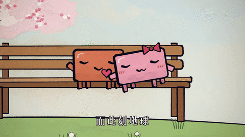
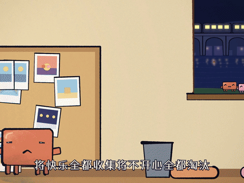
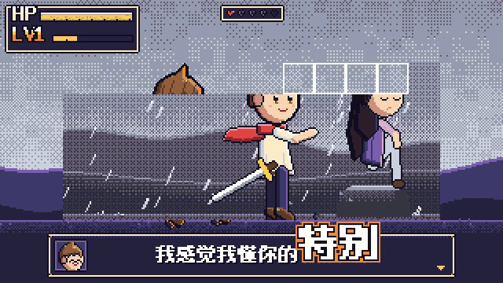
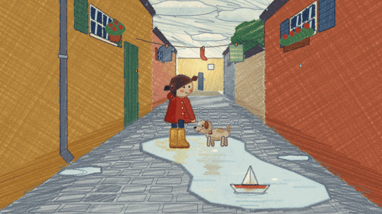
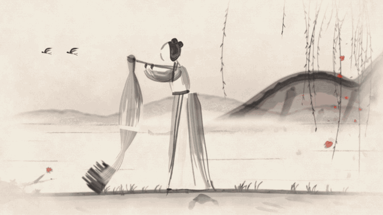
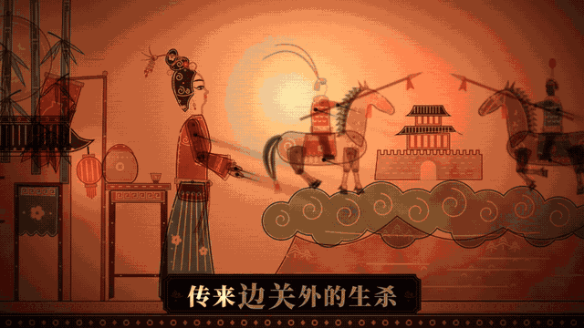
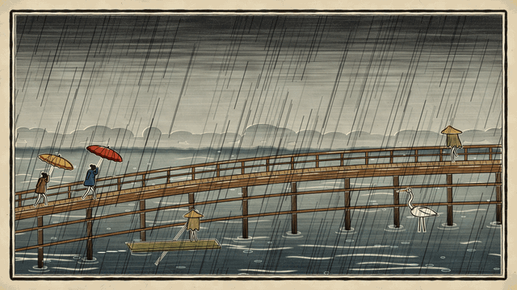
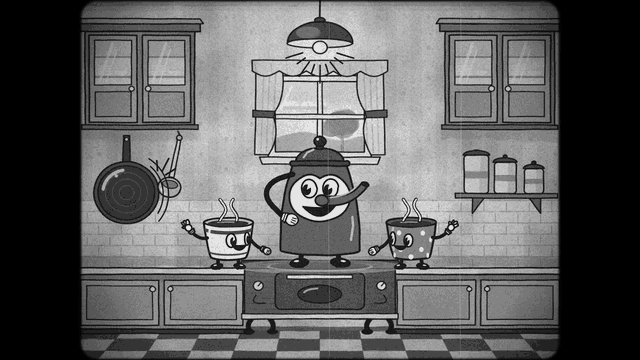
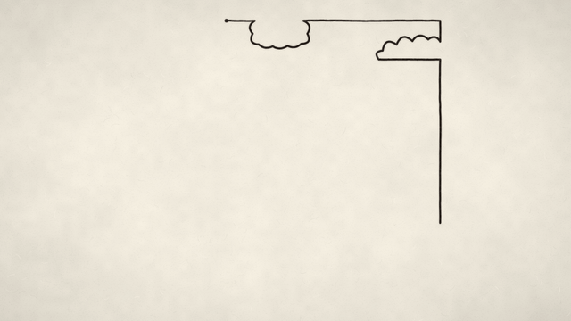

<h1 align="center">music-mv</h1>

<p align="center">
  <em>用 AI 写代码给一首歌做一支音乐 MV：每一帧都是代码画的，不是视频生成</em>
</p>

<p align="center">
  
  
  
</p>

<p align="center"><sub>An agent skill for making music videos in code — every frame is drawn by code, not generated. Docs are in Chinese.</sub></p>

<table>
<tr>
<td align="center" width="50%"><br><sub>《每一秒初吻》：镜头从长椅一路拉到整个地球，再推回来</sub></td>
<td align="center" width="50%"><br><sub>《每一秒初吻》：同一张长椅，春夏秋冬，一直坐到老</sub></td>
</tr>
<tr>
<td align="center" width="50%"><br><sub>《把回忆拼好给你》：一镜到底，从雪夜小镇抬进天空，落到海边</sub></td>
<td align="center" width="50%"><br><sub>《把回忆拼好给你》：从屋里转到夜空，烟花炸成一颗心</sub></td>
</tr>
</table>

<p align="center"><sub>用这套流程做的两支 MV 的片段。GIF 没有声音：歌的版权归原作者，这里不放带歌的视频。画面里的方块角色见 <a href="NOTICE.md">NOTICE</a>。</sub></p>

一个 agent skill，也是一份教程：

- **当 skill 用**：装好后跟 agent 说「给 song.mp3 做一支 MV」，它会按六步走（听懂歌 → 定画风 → 画角色 → 剧本和分镜 → 先出草图再做整片 → 看片修改），每个关键处停下来等你点头
- **当教程用**：不想装 skill，照 [教程.md](教程.md) 把提示词一段段发给你的 agent

不限模型：Claude Code、Codex 等能读写文件、跑命令的 agent 都能用。模型越强画面越细。

## 十种画风，各用各的画法

像素、拼贴、蜡笔、立体书、水墨、皮影、孔版这七种，放的是用这个 skill 做出来的整支 MV 里截的 6 秒（每支约 1 分钟，这里没有声音）；浮世绘、橡皮管卡通、一笔画放的是示范页面的画面。每种都是从头用这种风格自己的画法画的，不是同一张图换滤镜：

<table>
<tr>
<td align="center" width="50%"><br><sub><b>像素游戏风</b>：320×180 逐格画、32 色加抖动点阵、精灵逐帧换画，整支做成一局 RPG：勇者对上城堡里的心形 BOSS，必杀技切到大头近景，伤害数字跳出来，歌词进对话框</sub></td>
<td align="center" width="50%"><br><sub><b>纸艺拼贴</b>：剪的撕的纸片一层层贴，纸偶女孩的脸推到眼睛，眼睛里映出一片海，海面像纸一样揭开，露出一张拼图拼成的合照，纸条贴歌词</sub></td>
</tr>
<tr>
<td align="center" width="50%"><br><sub><b>蜡笔 / 水彩绘本</b>：蜡笔排线叠水彩晕染，雨里两个孩子撑着红伞，伞一抬，彩虹一笔笔涂满整条街</sub></td>
<td align="center" width="50%"><br><sub><b>纸艺立体书</b>：有厚度的纸片分层站开、互相投影，月下两个人转过身来，镜头拉远成一本立体书，书页一层层翻开，落到台上牵着红线的两个人</sub></td>
</tr>
<tr>
<td align="center" width="50%"><br><sub><b>中国水墨</b>：宣纸上墨分五色、飞白、留白，水袖一甩扫出一圈浓墨，花瓣跟着飞，再落到一枝红梅下，墨色之外只用一个朱红</sub></td>
<td align="center" width="50%"><br><sub><b>皮影戏</b>：油灯透过镂空的染色兽皮、叠处变暗，酒家外两骑对阵，灯色烧成一片红，再切到月下的侧脸，歌词刻在皮牌上</sub></td>
</tr>
<tr>
<td align="center" width="50%"><br><sub><b>浮世绘</b>：分色木版套印，木纹、马连擦痕、逐像素晕染；骤雨木桥，雨是斜落的刻线，雨停那拍印上新色版，白鹭飞起，歌词进竖题签</sub></td>
<td align="center" width="50%"><br><sub><b>Risograph 孔版印刷</b>：两三色半透明油墨叠印、网点颗粒、错版彩边，女孩骑着烟花火箭冲上夜空，烟火在身后一朵朵炸开</sub></td>
</tr>
<tr>
<td align="center" width="50%"><br><sub><b>1930s 橡皮管卡通</b>：4:3 黑白老胶片、派形眼、橡皮管手脚，老厨房随摇摆伸缩，光圈收到咖啡壶眨眼，小球按拍跳字</sub></td>
<td align="center" width="50%"><br><sub><b>一笔画</b>：整片一根不离纸、粗细不变的线，窗台上的花开了，一片花瓣按弧长变形成鸟、推出窗外落在手心，歌词也连笔写出来</sub></td>
</tr>
</table>

十种画风都有示范源码，在 [`examples/`](examples/)，每种一个 `scene.html`（5–6 秒的小场景），用浏览器直接打开就能拖着看。agent 做第 2 步时会读它们学画法；场景只是示范，做你的 MV 时场景从你的歌来。

## 能做什么

- **听懂歌**：歌词转成带时间轴的字幕，测 BPM、拍点、分段、突然安静和低音撤掉的地方，上网查这首歌的几种理解
- **十种画风**：像素游戏风、纸艺拼贴绘本、蜡笔 / 水彩绘本、纸艺立体书、中国水墨、皮影戏、浮世绘、Risograph 孔版印刷、1930s 橡皮管卡通、一笔画，也可以说你想要的
- **角色一致**：主角写成一个代码文件，每个镜头都从这里取，不会越画越走样
- **横屏、竖屏都行**：竖屏按抖音、视频号的界面摆，歌词和脸躲开下面的标题文案和右边的按钮
- **转场**：7 种整片方案（一镜到底、卡点切换、拼贴快切、嵌套缩放、原地看时间走、舞台书本老胶片、分格分屏）、45 种接法，按歌里的位置挑：鼓点上甩镜，副歌进来猛切，突然安静时定格
- **自己编排**：整支 MV 是 agent 写的一个网页，镜头、转场、歌词都按歌的拍点在里面编排（拍前起步、拍上落位，甩镜带动态模糊），不拿一段段画面去拼，转场不僵
- **自己会检查**：接触表看画面、帧差量节奏（找出像幻灯片的段、没打算的硬切、黑帧）、逐句核对歌词、音量和原曲对齐
- **学风格**：把喜欢的视频录下来，拆出配色、画法、节奏和转场，照着做一支新的

## 装

**任何 agent**（Claude Code、Codex、Cursor、Gemini CLI……）：把这句话发给它

```
帮我安装这个 skill：https://github.com/Win-Hao/music-mv
```

**或者用 [skills 命令行](https://github.com/vercel-labs/skills)**，一条命令装进 Claude Code、Codex、Cursor、Cline 等二十多种 agent：

```bash
npx skills add Win-Hao/music-mv -g
```

`-g` 装到你的用户目录，所有项目都能用；不加就只装进当前项目。

**只用 Claude Code**，也可以直接 clone：

```bash
git clone https://github.com/Win-Hao/music-mv ~/.claude/skills/music-mv
```

不支持 skill 的工具：让它读 `SKILL.md`，或者照 `教程.md` 发提示词。

要用到的东西（第一次用时 agent 会跑 `scripts/check_env.py` 检查，缺什么会告诉你）：

- Python 3.9+，和库 `numpy`、`librosa`、`Pillow`：`pip install -r requirements.txt`
- ffmpeg
- Node.js 18+ 和 puppeteer-core（逐帧渲染用）：项目文件夹里 `npm i puppeteer-core`，用本机的 Chrome、Edge 或 Chromium；都没有就 `npm i puppeteer`（自带一个 Chrome）
- 可选：Whisper（`pip install openai-whisper`）转歌词；不装就自己准备 `lyrics.srt`

## 用

新建一个文件夹，放进歌（`song.mp3`），在里面打开 agent：

> 给 song.mp3 做一支 MV，竖屏发抖音，只做副歌，画风想要纸艺拼贴

想全交给它、中间不用一步步确认，就直接说「画风、分镜你看着办，不用问我」。

想学一支视频的风格，把它录下来命名 `reference.mp4` 放进去：

> 学一下 reference.mp4 的风格，给 song.mp3 做一支 MV

脚本也可以自己跑（Windows 上把 `python3` 换成 `py -3`）：

```bash
mkdir -p mv && cp templates/mv/index.html templates/mv/kit.js mv/      # 整支 MV 的页面：画面、转场、歌词都写在这里
python3 scripts/analyze_song.py song.mp3 -o song-analysis.json --js mv/song.js   # 歌的骨架：BPM、拍点、分段、突变点；song.js 给页面卡拍子
# 预览：浏览器直接打开 mv/index.html，跟着歌放（空格播放，Shift + ← → 跳一拍）
node scripts/render_frames.mjs --page mv/index.html --fps 30 --out frames --encode render.mp4   # 逐帧渲、接成视频（片长用页面的 MV.duration）
python3 scripts/finalize_audio.py render.mp4 song.mp3 -o mv.mp4         # 原曲按原音量配上去（上一步会照你的文件夹把这条命令写好打印出来）
python3 scripts/contact_sheet.py mv.mp4 --every 0.5 -o review/sheet.jpg  # 接触表
python3 scripts/contact_sheet.py mv.mp4 --srt lyrics.srt -o review/lyrics.jpg   # 逐句核对歌词（格子下只写第几句）
python3 scripts/contact_sheet.py mv.mp4 --around 8,16.5 -o review/cuts.jpg      # 转场前后逐帧
python3 scripts/video_rhythm.py mv.mp4 --analysis song-analysis.json    # 切点、镜头时长、不动的段、黑帧
python3 scripts/srt2js.py lyrics.srt -o mv/lyrics.js --words lyrics-words.json  # 歌词带上逐字时间，字跟着唱的出
node scripts/render_frames.mjs --page mv/index.html --lyric-check       # 按帧核逐字歌词：开唱那一帧字出来没有
```

## 要多久

整支 MV（1–1.5 分钟）从开始到做完 7–10 小时，大部分时间在看片、提意见、改；改 4–9 版是常事。渲染：Canvas 画风很快，孔版印刷、皮影戏这类逐像素合成的约 0.2 秒一帧；p5.brush 笔刷画风慢在笔画多：笔画少的水彩画面约 0.3 秒一帧，角色多、排线涂色的蜡笔画面在 4 核电脑上 1.5–2 秒一帧（实测 30 秒的片子渲了一刻钟），换成核多的电脑会快一些。

## 文件

| 文件 | 内容 |
|---|---|
| `SKILL.md` | agent 照着走的流程 |
| `教程.md` | 给人看的六步教程和全部提示词 |
| `references/` | 画风、角色、分镜、转场、渲染、看片清单、学风格的细则 |
| `scripts/` | 环境检查、歌曲分析、接触表、节奏检查、逐帧渲染、音轨封装、字幕转换（带逐字时间）、汉字笔画数据 |
| `templates/` | 整支 MV 的页面模板（Canvas 2D、p5.brush 笔刷）和小工具 `kit.js`：拍点、缓动、转场遮罩和变形、歌词、动态模糊、预览 |
| `examples/` | 十种画风的原生示范（同一段 5 秒），源码就是画法参考 |
| `docs/` | README 里的预览图（不影响使用） |

## 版权

代码 MIT（见 `LICENSE`）。用到的第三方工具和库见 `NOTICE.md`。歌曲的版权归原作者，发布前确认平台允许使用。
