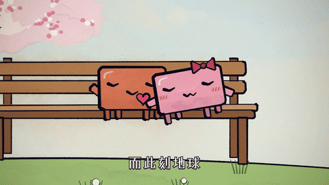
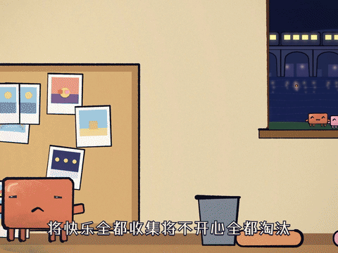

<h1 align="center">music-mv</h1>

<p align="center">
  <em>用 AI 写代码给一首歌做一支音乐 MV：每一帧都是代码画的，不是视频生成</em>
</p>

<p align="center">
  
  
  
</p>

<p align="center"><sub>An agent skill for making music videos in code — every frame is drawn by code, not generated. Docs are in Chinese.</sub></p>

<table>
<tr>
<td align="center" width="50%"><br><sub>《每一秒初吻》：镜头从长椅一路拉到整个地球，再推回来</sub></td>
<td align="center" width="50%"><br><sub>《每一秒初吻》：同一张长椅，春夏秋冬，一直坐到老</sub></td>
</tr>
<tr>
<td align="center" width="50%"><br><sub>《把回忆拼好给你》：一镜到底，从雪夜小镇抬进天空，落到海边</sub></td>
<td align="center" width="50%"><br><sub>《把回忆拼好给你》：从屋里转到夜空，烟花炸成一颗心</sub></td>
</tr>
</table>

<p align="center"><sub>用这套流程做的两支 MV 的片段。GIF 没有声音：歌的版权归原作者，这里不放带歌的视频。画面里的方块角色见 <a href="NOTICE.md">NOTICE</a>。</sub></p>

一个 agent skill，也是一份教程：

- **当 skill 用**：装好后跟 agent 说「给 song.mp3 做一支 MV」，它会按六步走（听懂歌 → 定画风 → 画角色 → 剧本和分镜 → 先出草图再做整片 → 看片修改），每个关键处停下来等你点头
- **当教程用**：不想装 skill，照 [教程.md](教程.md) 把提示词一段段发给你的 agent

不限模型：Claude Code、Codex 等能读写文件、跑命令的 agent 都能用。模型越强画面越细。

## 四种画风，各用各的画法

同一段 5 秒：雪夜街角，小螃蟹横着走进来，路灯卡在拍子上亮起，它蹦一下、冒出一颗心。四种风格都是从头用这种风格自己的画法画的，不是同一张图换滤镜：

<table>
<tr>
<td align="center" width="50%"><br><sub><b>像素游戏风</b>：320×180 逐像素画、24 色调色板、抖动点阵、逐帧换画，歌词进游戏对话框</sub></td>
<td align="center" width="50%"><br><sub><b>纸艺拼贴</b>：每样东西是一张剪的、撕的纸片，报纸、牛皮纸、花纸各有纹理，薄棉纸当灯光，纸条贴歌词</sub></td>
</tr>
<tr>
<td align="center" width="50%"><br><sub><b>蜡笔绘本</b>：p5.brush 的蜡笔笔触和排线，涂出线一点、露出纸纹，歌词按笔顺一笔笔写出来</sub></td>
<td align="center" width="50%"><br><sub><b>纸艺立体书</b>：有厚度的纸片分层站开、互相投影，浅景深，暖光打在纸上，像拍定格动画</sub></td>
</tr>
</table>

源码在 [`examples/`](examples/)，每种一个 `scene.html`。agent 做第 2 步时会读它们学画法，你也可以直接打开改。

## 能做什么

- **听懂歌**：歌词转成带时间轴的字幕，测 BPM、拍点、分段、突然安静和低音撤掉的地方，上网查这首歌的几种理解
- **四种画风**：像素游戏风、纸艺拼贴绘本、蜡笔 / 水彩绘本、纸艺立体书，也可以说你想要的
- **角色一致**：主角写成一个代码文件，每个镜头都从这里取，不会越画越走样
- **三种转场**：一镜到底、卡点切换、拼贴快切
- **自己会检查**：接触表看画面、帧差量节奏（找出像幻灯片的段、没打算的硬切、黑帧）、逐句核对歌词、音量和原曲对齐
- **学风格**：把喜欢的视频录下来，拆出配色、画法、节奏和转场，照着做一支新的

## 装

**任何 agent**（Claude Code、Codex、Cursor、Gemini CLI……）：把这句话发给它

```
帮我安装这个 skill：https://github.com/Win-Hao/music-mv
```

**或者用 [skills 命令行](https://github.com/vercel-labs/skills)**，一条命令装进 Claude Code、Codex、Cursor、Cline 等二十多种 agent：

```bash
npx skills add Win-Hao/music-mv -g
```

`-g` 装到你的用户目录，所有项目都能用；不加就只装进当前项目。

**只用 Claude Code**，也可以直接 clone：

```bash
git clone https://github.com/Win-Hao/music-mv ~/.claude/skills/music-mv
```

不支持 skill 的工具：让它读 `SKILL.md`，或者照 `教程.md` 发提示词。

要用到的东西（第一次用时 agent 会跑 `scripts/check_env.py` 检查，缺什么会告诉你）：

- Python 3.9+，和库 `numpy`、`librosa`、`Pillow`：`pip install -r requirements.txt`
- ffmpeg
- Node.js 18+（HyperFrames 渲染用，第一次会自动下载渲染器和一个无头 Chrome）
- 可选：Whisper（`pip install openai-whisper`）转歌词；不装就自己准备 `lyrics.srt`
- 出样图、草图和 p5.brush 水彩、蜡笔画风逐帧渲染时：项目文件夹里 `npm i puppeteer-core`（用本机的 Chrome，或者 HyperFrames 下载过的那个；都没有就 `npm i puppeteer`）

## 用

新建一个文件夹，放进歌（`song.mp3`），在里面打开 agent：

> 给 song.mp3 做一支 MV，横屏，画风想要纸艺拼贴

想学一支视频的风格，把它录下来命名 `reference.mp4` 放进去：

> 学一下 reference.mp4 的风格，给 song.mp3 做一支 MV

脚本也可以自己跑：

```bash
python3 scripts/analyze_song.py song.mp3 -o song-analysis.json          # 歌的骨架：BPM、拍点、分段、突变点
python3 scripts/contact_sheet.py mv.mp4 --every 0.5 -o review/sheet.jpg  # 接触表
python3 scripts/contact_sheet.py mv.mp4 --srt lyrics.srt -o review/lyrics.jpg   # 逐句核对歌词
python3 scripts/video_rhythm.py mv.mp4 --analysis song-analysis.json    # 切点、镜头时长、不动的段、黑帧
python3 scripts/finalize_audio.py render.mp4 song.mp3 -o mv.mp4         # 原曲按原音量封回去
```

## 要多久

整支 MV（1–1.5 分钟）从开始到做完 7–10 小时，大部分时间在看片、提意见、改；改 4–9 版是常事。渲染：Canvas 画风很快；p5.brush 水彩约 0.3 秒一帧，1 分钟成片要渲 20 分钟左右。

## 文件

| 文件 | 内容 |
|---|---|
| `SKILL.md` | agent 照着走的流程 |
| `教程.md` | 给人看的六步教程和全部提示词 |
| `references/` | 画风、角色、分镜、转场、渲染、看片清单、学风格的细则 |
| `scripts/` | 环境检查、歌曲分析、接触表、节奏检查、逐帧渲染、音轨封装、字幕转换 |
| `templates/` | 两条渲染路线的 HyperFrames 合成和逐帧页面、歌词层 |
| `examples/` | 四种画风的原生示范（同一段 5 秒），源码就是画法参考 |
| `docs/` | README 里的预览图（不影响使用） |

## 版权

代码 MIT（见 `LICENSE`）。用到的第三方工具和库见 `NOTICE.md`。歌曲的版权归原作者，发布前确认平台允许使用。
